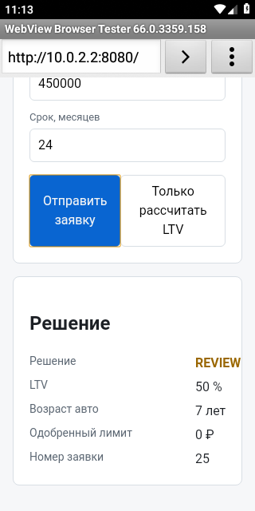

# ДЗ.2 — проверка сервиса на мобильном эмуляторе

Проверка выполнена на Android Emulator 9 (`emulator-5554`) через MCP-сервер
`claude-in-mobile` 4.4.1. Перед сценарием `/health` вернул `status: ok`, а форма
открылась в браузере эмулятора по адресу `http://10.0.2.2:8080`.

## Шаги

1. Через MCP получил список устройств и выбрал Android-эмулятор `emulator-5554`.
2. Запустил `WebView Browser Tester`, ввёл `http://10.0.2.2:8080` и открыл форму заявки.
3. Оставил синтетические значения формы по умолчанию, заменил пробег `84000` на `400001` и нажал «Отправить заявку».
4. В дереве мобильного интерфейса проверил фактический результат: поле `r-decision` содержит `REVIEW` (LTV — `50 %`, возраст авто — `7 лет`, номер заявки — `25`).
5. Прокрутил страницу к карточке решения и сохранил скриншот через мобильный MCP.

## Результат

Для пробега `400001` км система показала решение **REVIEW**.

## Сравнение с проверкой в обычном браузере

В мобильной проверке сложнее подготовка окружения: нужно загрузить эмулятор, дождаться
устройства в `adb`/MCP и обращаться к сервису через специальный адрес `10.0.2.2`, а не
через `localhost`. Из-за экранной клавиатуры и узкого viewport приходится отдельно
скрывать клавиатуру и прокручивать страницу до результата; в настольном браузере форма
и карточка решения обычно видны и управляются проще.
